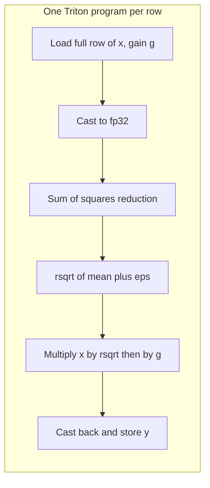

# Fused RMSNorm

> **Status: draft — kernel + tests on disk, no GPU numbers yet.** The design and
> correctness strategy are documented here. The benchmark results section is
> deliberately empty until the kernel runs on an A100; stub tables with
> placeholder numbers would be worse than no table at all.

RMSNorm is the per-token normalization used by every modern open-weights LLM
(LLaMA, Mistral, Qwen, Gemma). This kernel fuses the entire operation into one
HBM round trip per row. A CUDA C++ port of the same kernel, written out at the
instruction level, is in [cuda_rmsnorm.md](cuda_rmsnorm.md).

## 1. Math

For a row vector `x ∈ R^N` (one token's hidden state), a learned gain
`g ∈ R^N`, and stability epsilon `ε`:

```
RMSNorm(x)_i = g_i * x_i / sqrt( (1/N) * Σ_j x_j^2 + ε )
```

Contrast with LayerNorm, which additionally subtracts the mean and adds a bias:

```
LayerNorm(x)_i = g_i * (x_i - μ) / sqrt(σ² + ε) + b_i
```

The RMSNorm paper (Zhang & Sennrich, 2019, arXiv 1910.07467) argues that the
mean-subtraction step contributes little; only the *re-scaling* invariance
matters. Dropping it saves one reduction and one bias broadcast — small on paper,
significant in a memory-bound regime where every extra tensor pass costs an
entire HBM traversal.

**Why `ε` lives inside the sqrt, not outside.** Placing it inside the radicand
bounds the divisor away from zero *before* the sqrt takes it; placing it
outside would still allow the sqrt to underflow for extremely small activations.
The inside-the-sqrt form is what PyTorch's `F.rms_norm` uses, and matching that
convention is what makes the ref-vs-ref test possible.

**Why fp32 accumulation is required.** The reduction sums N squared values.
For `N = 4096` fp16 activations with unit-variance scale, the running sum
exceeds fp16's exact-integer range (2¹¹ = 2048) partway through and starts
rounding every subsequent add. Load fp16/bf16, cast to fp32, reduce and rsqrt
in fp32, cast back at store time.

## 2. Kernel design



- **Row-parallel launch.** Grid is 1-D of size `M` (total tokens). Each program
  handles exactly one row. Rows are independent so no cross-program
  communication is needed.
- **BLOCK_SIZE = next_power_of_2(N).** The full row fits in one tile. This is
  the standard Triton layer-norm-tutorial pattern; for LLaMA hidden dims
  (4096 / 5120 / 8192) the row lives comfortably in per-SM SRAM.
- **Single-pass, fused arithmetic.** Load once, compute sum-of-squares → rsqrt
  → scale by weight → store. No intermediate tensors materialized to HBM.
- **fp32 accumulation.** Enforced by `tl.load(...).to(tl.float32)` before the
  reduction.
- **Autotune scope.** `BLOCK_SIZE` is pinned by the input shape, so the useful
  sweep is `num_warps ∈ {1, 2, 4, 8, 16}` and `num_stages ∈ {2, 3, 4}`, keyed on
  `N`.

## 3. Correctness strategy — two-layer defense

A single reference implementation can be silently wrong. If both our
`rmsnorm_ref` and our Triton kernel share the same bug, all tests pass and the
kernel ships broken. We anchor the reference itself:

```
torch.nn.functional.rms_norm  ←  rmsnorm_ref  ←  Triton kernel
        (PyTorch built-in)       (our impl)         (our impl)
```

- `test_ref_matches_torch_functional` compares `rmsnorm_ref(x, w, eps)` against
  `F.rms_norm(x, [N], w, eps)` across the full shape/dtype grid.
- `test_rmsnorm_matches_reference` compares the Triton kernel against
  `rmsnorm_ref` across the same grid.

If a test in the first group fails, we fix the reference. If a test in the
second group fails (while the first passes), the bug is in the Triton kernel.
The split gives us localized diagnostics for free.

## 4. Benchmark

`benchmarks/bench_rmsnorm.py`: `M = 16384` rows, `N ∈ {1024, 2048, 4096,
5120, 8192}`, fp16 and bf16 (fp32 optional). Every tensor is at least 32 MiB
and `do_bench` flushes L2 before each timed call, so no number is a cache
hit. Median of `do_bench`; bytes per call counted as read x + write y + read
weight once, and the same count applied to every column.

Columns:

1. **Triton** (this kernel) and **CUDA C++** (the port in
   [cuda_rmsnorm.md](cuda_rmsnorm.md)).
2. **PyTorch eager unfused** — the naive
   `x * torch.rsqrt(x.pow(2).mean(-1, keepdim=True) + eps) * weight`.
   This is the "what fusion buys you" honest number.
3. **`torch.nn.functional.rms_norm`** — PyTorch's built-in fused path.
   Apples-to-apples comparison for a framework-provided op.
4. **`torch.compile`** — reported for completeness only. `torch.compile`
   itself lowers to Triton; matching it is expected, exceeding it is where
   hand-tuning starts to earn its keep. See `DECISIONS.md`.

<!-- RESULTS:START -->
**NVIDIA A100-SXM4-80GB** · driver 595.91.07 · CUDA 12.8 · torch 2.8.0+cu128 · triton 3.4.0 · 2026-11-07 · peak 2039 GB/s (device attributes: 2 x mem_clock_rate x mem_bus_width)

Timing: triton.testing.do_bench median; L2 flushed before each timed call. Bytes per call: read x once + write y once + read weight once; the same count is used for every column, so GB/s is *effective* bandwidth on a shared roofline axis.

| shape | dtype | bytes/call | triton ms | triton GB/s | triton % peak | cuda GB/s | cuda % peak | eager GB/s | F.rms_norm GB/s | torch.compile GB/s | triton vs cuda | triton vs eager | triton vs F.rms_norm | triton vs torch.compile |
|---|---|---|---|---|---|---|---|---|---|---|---|---|---|---|
| M=16384 N=1024 | float16 | 64 MiB | 0.0512 | 1,312 | 64.3% | 1,307 | 64.1% | 160 | 138 | 1,321 | 1.00x | 8.21x | 9.53x | 0.99x |
| M=16384 N=2048 | float16 | 128 MiB | 0.0876 | 1,532 | 75.2% | 1,505 | 73.8% | 188 | 146 | 1,459 | 1.02x | 8.15x | 10.53x | 1.05x |
| M=16384 N=4096 | float16 | 256 MiB | 0.1640 | 1,637 | 80.3% | 1,626 | 79.7% | 195 | 150 | 1,672 | 1.01x | 8.39x | 10.94x | 0.98x |
| M=16384 N=5120 | float16 | 320 MiB | 0.2028 | 1,655 | 81.2% | 1,556 | 76.3% | 197 | 151 | 1,717 | 1.06x | 8.40x | 10.96x | 0.96x |
| M=16384 N=8192 | float16 | 512 MiB | 0.3171 | 1,693 | 83.0% | 1,674 | 82.1% | 200 | 153 | 1,729 | 1.01x | 8.48x | 11.07x | 0.98x |
| M=16384 N=1024 | bfloat16 | 64 MiB | 0.0504 | 1,332 | 65.3% | 1,332 | 65.3% | 175 | 137 | 1,328 | 1.00x | 7.63x | 9.72x | 1.00x |
| M=16384 N=2048 | bfloat16 | 128 MiB | 0.0877 | 1,531 | 75.1% | 1,505 | 73.8% | 187 | 145 | 1,464 | 1.02x | 8.18x | 10.58x | 1.05x |
| M=16384 N=4096 | bfloat16 | 256 MiB | 0.1649 | 1,628 | 79.9% | 1,626 | 79.8% | 194 | 149 | 1,678 | 1.00x | 8.39x | 10.94x | 0.97x |
| M=16384 N=5120 | bfloat16 | 320 MiB | 0.2031 | 1,652 | 81.0% | 1,558 | 76.4% | 196 | 150 | 1,715 | 1.06x | 8.43x | 11.02x | 0.96x |
| M=16384 N=8192 | bfloat16 | 512 MiB | 0.3173 | 1,692 | 83.0% | 1,674 | 82.1% | 199 | 152 | 1,728 | 1.01x | 8.52x | 11.15x | 0.98x |
<!-- RESULTS:END -->

## 5. Roofline analysis

RMSNorm is textbook memory-bound.

**Bytes moved per row** (fp16 input, fp16 output):
- Read x: `N * 2` bytes
- Write y: `N * 2` bytes
- Read weight: `N * 2` bytes, once per call: the first programs pull it from
  HBM, every later program hits it in L2.
- **Total per call:** `2 * M * N * 2 + N * 2` bytes. This is the count the
  benchmark uses.

**FLOPs per row:** `N` squares + `N` sums (reduction) + `2N` scales ≈ `4N`.

**Arithmetic intensity:** `4N FLOPs / 4N bytes = 1 FLOP/byte`.

The A100's balance point (peak-compute / peak-BW) is roughly `19.5 TFLOPS / 2.0 TB/s ≈ 10 FLOPs/byte`. We're at 1 FLOP/byte, an order of magnitude below the balance point — decisively memory-bound. **Wall-clock is dominated by HBM traffic; the FLOPs are free.**

The benchmark reports the achieved fraction of the device's peak (A100 80GB
SXM: 2039 GB/s, derived from memory clock × bus width). The roofline floor
for a call is simply `bytes / peak`; the gap between that and the measured
time is what the autotune pass and the follow-ups in `cuda_rmsnorm.md` go
after.

## 6. Lesson learned

Reserved for the biggest surprise from the autotune sweep or a
benchmark-hygiene bite (L2 cache reuse, warm-up count, numerical issues
at `N=8192` bf16, etc). Deliberately not pre-written — the lesson is
whichever thing we actually hit on the GPU, not whatever I'd speculate about
from a Mac.
