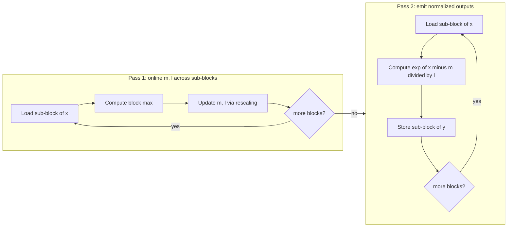

# Online softmax

> **Status: validated on an NVIDIA A100-SXM4-80GB (2026-11-07).** The tests passed on that GPU, and the
> benchmark tables below are generated from `benchmarks/results/` by `scripts/update_docs.py`.

Numerically-stable softmax computed with the Milakov & Gimelshein (2018)
online formulation. Softmax is applied over the last dim of a tensor of
any rank.

## 1. Three flavors of softmax

Given a row `x` of length `N`:

**Naive:**
```
y = exp(x) / sum(exp(x))
```
Overflows for `|x| > ~88` in fp32, `|x| > ~11` in fp16. Unusable in practice.

**Safe (standard):** take two passes.
```
m = max(x)
y = exp(x - m) / sum(exp(x - m))
```
Numerically stable. This is what `F.softmax` and most hand-written softmax
implementations do.

**Online (streaming):** process `x` in sub-blocks. Maintain `(m, l)` where
`m` is the max seen so far and `l` is `sum(exp(x_seen - m))`. For each new
sub-block:

```
m_new = max(m, max_of_block)
l_new = l * exp(m - m_new) + sum(exp(block - m_new))
m, l = m_new, l_new
```

The rescaling `l * exp(m - m_new)` is the clever bit: when the max shifts
up, every previously-accumulated `exp(x - m)` is `exp(m_new - m)` times too
large and gets corrected in one multiply.

One edge case: if every value seen so far is `-inf` (a fully masked prefix,
such as long left padding), `m_new` is `-inf` too and `m - m_new` is
`(-inf) - (-inf) = NaN`, which would turn the whole row into NaN. The kernel
subtracts 0 instead of `m_new` while `m_new` is `-inf`, so `l` stays 0 until
the first finite value arrives.

## 2. Why online matters here

For rows that fit in one SRAM tile, online softmax and safe softmax
produce identical outputs with identical performance — safe softmax just
does the two passes with one `tl.max` and one `tl.sum`. **Online only
wins when the row doesn't fit in one tile.**

That's not currently the case in our benchmark (all configs have `N` small
enough to fit), but we implement the online version anyway because:

1. The name on the roadmap is "online softmax" — so we build what it says.
2. It generalizes directly to streaming attention (FlashAttention) in later
   phases.
3. It demonstrates the running-state pattern that's a recurring motif in
   high-performance kernels.

The kernel takes a `block_size` arg; set it smaller than `N` to actually
exercise the online loop. The benchmark deliberately includes `N = 16384`
to force multiple iterations.

## 3. Kernel design



- One Triton program per row. Grid shape `(M,)`.
- Each program iterates over its row in `BLOCK_SIZE` sub-blocks, twice.
- fp32 accumulators for `(m, l)` — the exponentiation is where
  low-precision bites hardest.
- The two-pass structure means this kernel reads each row twice. For the
  row sizes here the second read of a row that was just read is served
  from L2, so the HBM traffic is one read plus one write, the same as a
  single-pass kernel; the extra cost is L2 bandwidth and instructions,
  which a safe-softmax kernel that holds the row in SRAM does not pay.
  The benchmark counts `2 * M * N * sizeof(dtype)` for every column and
  shows both regimes (rows that fit one block, rows that do not).

## 4. Benchmark

`benchmarks/bench_softmax.py`. Shapes `(M, N)`: `(32768, 1024)`,
`(16384, 2048)`, `(8192, 4096)`, `(2048, 16384)`, `(4096, 32768)`; every
tensor is at least 64 MiB in fp16. The last two make the online loop
iterate 16 and 32 sub-blocks per pass.

Baselines: eager naive two-pass, `F.softmax`, `torch.compile`. Median of
`do_bench`, L2 flushed before each timed call.

<!-- RESULTS:START -->
**NVIDIA A100-SXM4-80GB** · driver 595.91.07 · CUDA 12.8 · torch 2.8.0+cu128 · triton 3.4.0 · 2026-11-07 · peak 2039 GB/s (device attributes: 2 x mem_clock_rate x mem_bus_width)

Timing: triton.testing.do_bench median; L2 flushed before each timed call. Bytes per call: read x once + write y once; the same count is used for every column, so GB/s is *effective* bandwidth on a shared roofline axis.

| shape | dtype | bytes/call | triton ms | triton GB/s | triton % peak | eager GB/s | F.softmax GB/s | torch.compile GB/s | triton vs eager | triton vs F.softmax | triton vs torch.compile |
|---|---|---|---|---|---|---|---|---|---|---|---|
| M=32768 N=1024 | float16 | 128 MiB | 0.1016 | 1,321 | 64.8% | 238 | 1,095 | 1,379 | 5.56x | 1.21x | 0.96x |
| M=16384 N=2048 | float16 | 128 MiB | 0.0956 | 1,405 | 68.9% | 265 | 968 | 1,173 | 5.30x | 1.45x | 1.20x |
| M=8192 N=4096 | float16 | 128 MiB | 0.0999 | 1,343 | 65.9% | 256 | 707 | 1,452 | 5.24x | 1.90x | 0.92x |
| M=2048 N=16384 | float16 | 128 MiB | 0.1399 | 960 | 47.1% | 264 | 1,160 | 1,469 | 3.63x | 0.83x | 0.65x |
| M=4096 N=32768 | float16 | 512 MiB | 0.5005 | 1,073 | 52.6% | 291 | 1,174 | 1,322 | 3.68x | 0.91x | 0.81x |
| M=32768 N=1024 | bfloat16 | 128 MiB | 0.0927 | 1,448 | 71.0% | 265 | 1,195 | 1,383 | 5.47x | 1.21x | 1.05x |
| M=16384 N=2048 | bfloat16 | 128 MiB | 0.0951 | 1,412 | 69.2% | 264 | 964 | 1,138 | 5.34x | 1.46x | 1.24x |
| M=8192 N=4096 | bfloat16 | 128 MiB | 0.1006 | 1,334 | 65.4% | 256 | 710 | 1,400 | 5.20x | 1.88x | 0.95x |
| M=2048 N=16384 | bfloat16 | 128 MiB | 0.1406 | 955 | 46.8% | 263 | 1,138 | 1,426 | 3.63x | 0.84x | 0.67x |
| M=4096 N=32768 | bfloat16 | 512 MiB | 0.5009 | 1,072 | 52.6% | 290 | 1,159 | 1,303 | 3.69x | 0.92x | 0.82x |
<!-- RESULTS:END -->

## 5. Lesson learned

Deferred until GPU validation.
